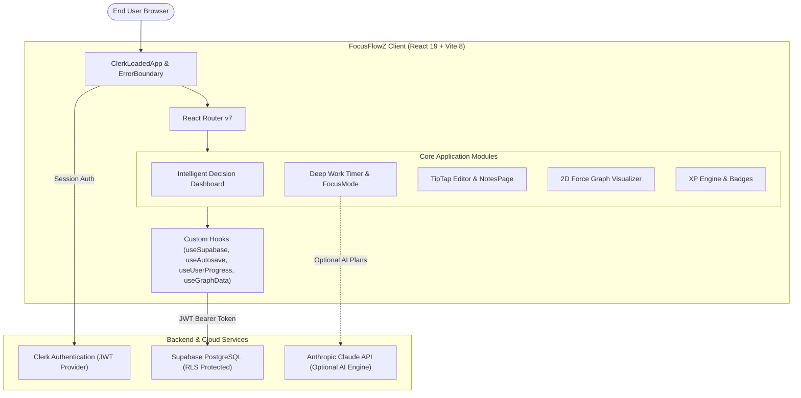

# 🏗️ System Architecture & Design

FocusFlowZ is designed as a modular, client-driven Single Page Application (SPA) backed by cloud primitives (Clerk for identity, Supabase for relational storage, and Vercel for edge distribution).

---

## 🧩 Key Architectural Principles

### 1. Zero Custom Node Server (Direct-to-Database via RLS)
* The frontend interacts directly with Supabase via `@supabase/supabase-js`.
* Security is enforced at the database layer using PostgreSQL **Row Level Security (RLS)** policies that validate Clerk's signed JWT token (`auth.jwt() ->> 'sub' = user_id`).
* This eliminates the cost, latency, and maintenance overhead of an intermediary custom API server while providing bank-grade isolation.

### 2. Client-Side Resilience & Offline-Friendly State
* **Autosave Engine**: [`useAutosave.js`](../src/hooks/useAutosave.js) uses refs and `AbortController` to prevent stale closure writes, concurrent race conditions, and out-of-order document saves.
* **Timer Drift Recovery**: Timers compute elapsed time against wall-clock timestamps stored in `localStorage` rather than relying solely on `setInterval`, preventing timing errors when tabs are backgrounded or browser windows sleep.
* **Deterministic Fallbacks**: AI features automatically fall back to algorithmic generators if API keys are absent or network requests are blocked.

### 3. Route Hierarchy

| Route | View Component | Protection | Description |
| :--- | :--- | :---: | :--- |
| `/` | `Landing.jsx` | Public | Editorial landing page with features showcase |
| `/login` | `Login.jsx` | Public | Clerk SignIn modal |
| `/signup` | `Signup.jsx` | Public | Clerk SignUp modal |
| `/dashboard` | `Dashboard.jsx` | Protected | Next Action Intelligence, stats, and weekly analytics |
| `/sessions` | `Sessions.jsx` | Protected | Focus sessions list, filtering, and history |
| `/create-session` | `CreateSession.jsx` | Protected | Session setup wizard (Custom vs. AI-generated) |
| `/session/:id` | `SessionDetail.jsx` | Protected | Session plan overview, steps checklist, and execution trigger |
| `/focus` | `FocusMode.jsx` | Protected | Full-screen immersion timer with milestone steps |
| `/notes` | `NotesPage.jsx` | Protected | Document workspace, folder tree, search, and card view |
| `/notes/:id` | `NoteEditor.jsx` | Protected | Full TipTap rich document editor with backlinks |
| `/graph` | `GraphView.jsx` | Protected | Interactive 2D knowledge graph |
| `/insights` | `FocusInsights.jsx` | Protected | Deep cognitive work metrics, fatigue detection, and XP trends |
| `/analytics` | `Analytics.jsx` | Protected | High-level data visualization & charts |
| `/profile` | `Profile.jsx` | Protected | User stats, identity archetype, streak heatmap, and badges |

---

## 🎨 Design Tokens & Theming
FocusFlowZ implements a dual-mode editorial theme managed by [`ThemeProvider.jsx`](../src/context/ThemeProvider.jsx):
* **Parchment Mode (Light)**: Warm editorial aesthetics using `--cream: #f5f0e8`, `--parchment: #ede7d9`, and `--gold: #c4913a` styled with Playfair Display and IBM Plex Mono.
* **Obsidian Mode (Dark)**: Sleek low-contrast dark mode using `--bg: #141210`, `--surface: #1e1b18`, and `--border: #2e2a24`.
